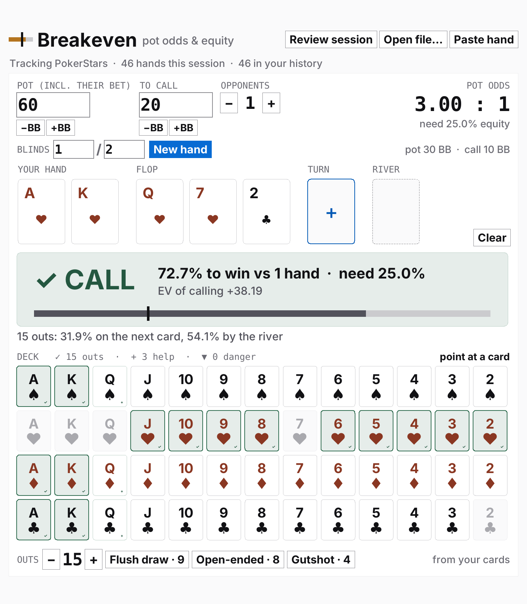
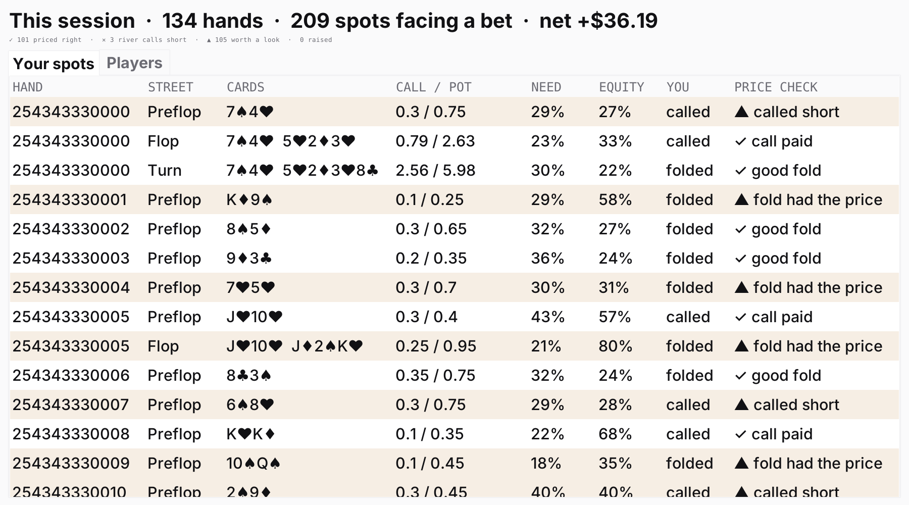
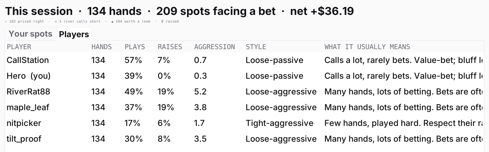

<div align="center">


# Breakeven

**Know the price of every call.**

A free pot odds and equity calculator for Texas Hold'em that also reviews your PokerStars sessions.<br>
Enter the pot and the bet and it tells you, instantly, whether calling pays.

[](https://github.com/brignano/breakeven/releases/latest)
[](https://github.com/brignano/breakeven/releases)
[](https://github.com/brignano/breakeven/actions/workflows/build.yml)
[](LICENSE)

[**Download for Windows**](https://github.com/brignano/breakeven/releases/latest/download/Breakeven-windows.zip) · [**Download for Mac**](https://github.com/brignano/breakeven/releases/latest/download/Breakeven-mac.zip)

<picture>
  <source media="(prefers-color-scheme: dark)" srcset="docs/images/calculator-dark.png">
  
</picture>

</div>

## Why Breakeven

- **A verdict, not a formula.** A big **✓ CALL** or **✕ FOLD** with your equity, the equity you need and the EV of calling. It updates as you type. There's no button to press.
- **Your outs and the danger cards, in colour.** On the flop and turn, every card that could come next is checked. Cards that put you ahead turn green, and cards that help your opponents turn red. It counts your outs for you.
- **Review every session automatically.** Breakeven picks up your PokerStars hand histories and grades every spot where you faced a bet: calls that paid, calls that didn't, and folds worth a second look.
- **Know who you're up against.** See how loose, tight, passive or aggressive everyone at your table plays, with what that usually means for you.
- **Private and free.** No account, no subscription, no internet connection. It's open source under the MIT license.

## Download

| | |
|---|---|
| **Windows** | [Breakeven-windows.zip](https://github.com/brignano/breakeven/releases/latest/download/Breakeven-windows.zip). Unzip it and double-click `Breakeven.exe` |
| **Mac** (Apple Silicon, M1 and later) | [Breakeven-mac.zip](https://github.com/brignano/breakeven/releases/latest/download/Breakeven-mac.zip). Unzip it and drag `Breakeven` into Applications |

Nothing else to install. Older versions are on the [releases page](https://github.com/brignano/breakeven/releases).

<details>
<summary><b>Your computer warns you the first time you open it?</b> That's expected. Here's how to open it.</summary>

The app isn't signed yet (signing costs money every year), so the first launch shows a warning. You only have to do this once.

- **Windows** shows "Windows protected your PC". Click **More info**, then **Run anyway**.
- **Mac** says the app "can't be opened". Open **System Settings → Privacy & Security**, scroll down, and click **Open Anyway**. On older macOS versions, right-click the app and choose **Open** instead.

Every release is built in public from this repository by GitHub Actions ([`build.yml`](.github/workflows/build.yml)), so you can check exactly what went into it.

</details>

## The calculator

1. Type the **pot** (including the bet you're facing) and what it costs **to call**.
2. Click your two cards in the deck, then the flop, turn and river as they come. Cards are optional, and the pot odds work without them.
3. Set how many **opponents** are still in the hand.

That's it. Breakeven shows the **pot odds** and the **equity you need**, then runs 5,000 simulated hands to find **your equity**. On the flop and turn it marks every **✓ out** and **▼ danger card** in the deck. Point at any card to see your chance to win if it comes.

The **+BB / −BB** buttons step amounts a big blind at a time, and **New hand** posts the blinds and clears the cards. The window scales to any size and follows your system's light or dark mode.

## Review your PokerStars sessions

Leave Breakeven open while you play, or open it afterwards. It finds PokerStars' hand history folder on its own and keeps count: *Tracking PokerStars · 42 hands this session*. Click **Review session**.

**Your spots** lists every time you faced a bet and checks the price you paid. Select a row to load that exact spot into the calculator.

<picture>
  <source media="(prefers-color-scheme: dark)" srcset="docs/images/review-spots-dark.png">
  
</picture>

**Players** shows how everyone at your table plays, read from every hand of theirs in your history.

<picture>
  <source media="(prefers-color-scheme: dark)" srcset="docs/images/review-players-dark.png">
  
</picture>

You can also open any hand history file, or paste a hand copied from PokerStars.

**[Read the full guide →](docs/usage.md)**: every input, how outs and danger cards are worked out, and what each price check and player stat means.

## FAQ

**Is it allowed on PokerStars?**
Breakeven only reads finished hands from the files PokerStars writes itself. It never reads the PokerStars window or memory, and never looks at a hand in progress. Poker sites ban software that advises you *during* a hand, and trackers built on your own hand histories are a long-accepted category. Breakeven isn't on PokerStars' list of approved tools, though, so check their current rules before keeping it open beside a real-money table. If in doubt, review after you play. [More on playing by the rules](docs/usage.md#playing-by-the-rules).

**Does it send my hands anywhere?**
No. Breakeven makes no network connections at all. Your hands stay on your computer.

**Does it account for implied odds or reads?**
No. The verdict is pot odds against random hands. That's the honest baseline. Your read on the other players is still yours to add.

**Which games does it support?**
Texas Hold'em, in cash games and tournaments. Hand history review reads PokerStars hands. Earlier releases were called Poker Helper.

## For developers

The app is one Python file and uses only the standard library (Tkinter).

```bash
python3 breakeven.py
```

```bash
pip install pytest && pytest -q
```

### Design system

Colours, type and the mark follow [brignano/design](https://github.com/brignano/design) (tool tier). `assets/tokens.css` is a copy of that repo's `tokens.css` at the release named by `DESIGN_TOKENS` in `.github/workflows/build.yml`, and CI fails if the two drift. The app reads every colour from that file, in light or dark, so `breakeven.py` holds no hex of its own (a test checks). To move to a newer release, replace the file, bump `DESIGN_TOKENS`, and regenerate the icon with `pip install pillow && python3 scripts/make_icon.py`.

### Releasing

In the Actions tab, open **build**, click **Run workflow**, and enter a version such as `v0.2.0`. You can also push a tag with that name. Either way, GitHub Actions runs the tests, builds the Windows and Mac apps with PyInstaller, and attaches both zips to a release. Every push to `main` also builds them, and you can download those builds from the Actions run.

### Docs

`docs/` holds what users read: the [guide](docs/usage.md) and its screenshots. Designs and specs live in [`proposals/`](proposals/README.md), and decisions in [`decisions/`](decisions/README.md), one ADR per decision.

The screenshots in `docs/images/` are real captures of the app on sample hands. `docs/images/social-preview.png` is the repository's link preview (Settings → Social preview).

## License

[MIT](LICENSE)
