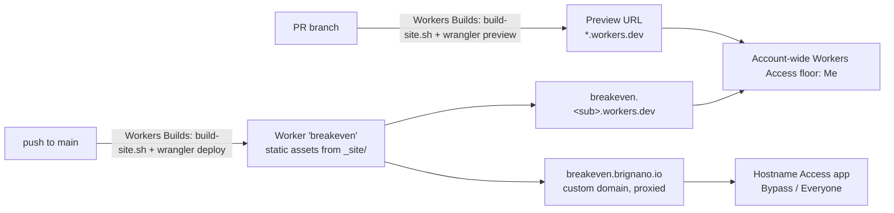

# Product page at breakeven.brignano.io

Status: proposed
Issue: #24

## Summary

Breakeven gets one static product page at `breakeven.brignano.io`, made for
poker players rather than developers. It says the same things the README says:
the tagline, both downloads, the calculator screenshot, the features, session
review, privacy and the FAQ. The layout follows the design system's
product-page structure (`product-page.css`, `DESIGN.md` §13).

The page is plain HTML and CSS in this repo. A Cloudflare Worker with static
assets serves it, and Workers Builds deploys it with PR previews. Only the
hostname is public. `workers.dev` and every preview stay behind the `Me`
Access floor.

Nothing in this PR is code. It is the design for Anthony to approve.

## What the user sees

### Layout sketch

The bands come in the fixed order from `DESIGN.md` §13 (header, hero, story,
close, footer). Desktop is shown. On a phone every band is one column, and the
media sits under the text.

```
┌──────────────────────────────────────────────────────────────────────┐
│ [icon] Breakeven     Calculator  Review  FAQ   ● Free  [ Download ]  │  .pp-header (sticky)
├──────────────────────────────────────────────────────────────────────┤
│  ● Free for Windows and Mac                                          │  .pp-hero
│                                                  ┌────────────────┐  │
│  Know the price of every call.                   │ calculator     │  │
│                                                  │ screenshot     │  │
│  A free pot odds and equity calculator for       │ (light or dark │  │
│  Texas Hold'em that also reviews your            │  with the OS)  │  │
│  PokerStars sessions.                            │                │  │
│                                                  └────────────────┘  │
│  [ Download ]  ( View on GitHub )                                    │
│  Windows · Mac with Apple Silicon · No account                       │
├──────────────────────────────────────────────────────────────────────┤
│ 01 / THE CALCULATOR   A verdict, not a formula.                      │  .pp-chapter
│                       body · 3 points: verdict / outs & danger /     │
│                       updates as you type                            │
├──────────────────────────────────────────────────────────────────────┤
│ 02 / SESSION REVIEW   Every spot you faced a bet, graded.            │
│                       body · figure: review-spots                    │
│                       "Know who you're up against." figure: players  │
├──────────────────────────────────────────────────────────────────────┤
│ 03 / PRIVATE & FREE   Your hands never leave your computer.          │
│                       3 points: no account / no network / MIT        │
├──────────────────────────────────────────────────────────────────────┤
│ 04 / QUESTIONS        The things players ask first.                  │
│                       4 FAQ entries (<details>)                      │
├──────────────────────────────────────────────────────────────────────┤
│  Download Breakeven.                     ┌──────────────────────────┐│  .pp-close #download
│  Free. Nothing else to install.          │ [ Download for Windows ] ││
│                                          │ [ Download for Mac     ] ││  .pp-panel
│                                          │ ▸ A warning the first    ││
│                                          │   time you open it?      ││
│                                          │ Older versions · Source  ││
│                                          └──────────────────────────┘│
├──────────────────────────────────────────────────────────────────────┤
│ [icon] Breakeven · A pot odds calculator for Hold'em.  GitHub  Guide │  .pp-footer
│ © 2026 Anthony Brignano. All rights reserved.                        │
└──────────────────────────────────────────────────────────────────────┘
```

How the issue's list maps onto the bands:

| Issue asks for | Where it goes |
|---|---|
| Hero with tagline and download buttons | `.pp-hero`: thesis, subhead, primary action (Decision 2) |
| Calculator screenshot, light and dark | `.pp-media` in the hero |
| Feature list | Chapters 01 and 03, as `.pp-points` |
| Review screenshots | Chapter 02, two `.pp-figure`s |
| FAQ | Chapter 04 (Decision 3) |
| Link to the repo | Hero secondary action, close panel and footer |

### Copy outline

All copy comes from the current README. The page adds no new claims.

- **`<title>`:** `Breakeven: pot odds and equity calculator for Texas Hold'em`
- **Status (header and hero):** `.pp-status data-state="open"`, reading
  "Free for Windows and Mac". The word carries the meaning, and the dot is
  extra.
- **Thesis (h1):** "Know the price of every call."
- **Subhead:** "A free pot odds and equity calculator for Texas Hold'em that
  also reviews your PokerStars sessions. Enter the pot and the bet, and it
  tells you instantly whether calling pays."
- **Actions:** primary "Download" (to `#download`), secondary "View on GitHub".
- **Note under the actions:** "Windows · Mac with Apple Silicon (M1 and later) ·
  No account, no internet connection."
- **Hero media alt text:** the README's alt text for `calculator-*.png`.
- **01 / The calculator.** Headline "A verdict, not a formula." Body: the
  README's "The calculator" in two sentences. Points:
  - *A clear verdict:* ✓ CALL or ✕ FOLD, with your equity, the equity you need
    and the EV of calling.
  - *Outs and danger cards:* the cards that put you ahead turn green, and the
    ones that help them turn red.
  - *No button to press:* it updates as you type and runs 5,000 simulated hands.
- **02 / Session review.** Headline "Every spot you faced a bet, graded."
  Body: picks up PokerStars hand histories on its own and checks the price you
  paid. Figure: `review-spots-*` with the README's alt text. Second paragraph:
  "Know who you're up against", then the Players figure (`review-players-*`).
- **03 / Private and free.** Headline "Your hands never leave your computer."
  Points: *No account*, *No network connections*, *Open source* (MIT, built in
  public by GitHub Actions).
- **04 / Questions.** The README's four FAQ entries, word for word: "Is it
  allowed on PokerStars?", "Does it send my hands anywhere?", "Does it account
  for implied odds or reads?", "Which games does it support?". Each one is a
  `<details>` that is closed by default. The PokerStars answer links to
  `docs/usage.md#playing-by-the-rules` on GitHub.
- **Close.** Headline "Download Breakeven." Subhead "Free. Nothing else to
  install." The panel holds the two platform buttons, the README's unsigned-app
  `<details>` ("A warning the first time you open it?"), and links to older
  releases and the full guide.
- **Footer.** The brand and "A pot odds and equity calculator for Texas
  Hold'em.", links (GitHub, Guide, Releases, License), then the legal line
  `© {year} Anthony Brignano. All rights reserved.`. Breakeven has no Privacy
  or Terms page, so those links are left out, as §13 says.

### Light and dark screenshots

The page sets no `data-theme`, so the tokens follow the OS (`DESIGN.md` §11).
Each screenshot is a `<picture>` with a `prefers-color-scheme: dark` source,
the same pattern the README uses, so the screenshot and the page always match.
There is no theme toggle. A toggle would need JavaScript and would also have
to swap the `<picture>` sources, and the page doesn't need it.

Every `` has `width`/`height` (no layout shift). Everything below the
hero uses `loading="lazy"`, and the hero image uses `fetchpriority="high"`.

## How it's built

### Files

```
site/
  index.html          the page; {{YEAR}} placeholder in the footer
  site.css            the few rules product-page.css lacks (FAQ <details>,
                      the download panel's two stacked buttons); tokens only
  404.html            "Nothing here. Go to Breakeven."
  robots.txt          allow all
scripts/
  build-site.sh       assembles _site/ (below)
wrangler.jsonc        name "breakeven", assets.directory "_site"
.gitignore            + _site/
```

There's no `package.json` and no framework. `scripts/build-site.sh` is about
ten lines of POSIX `sh`:

```sh
rm -rf _site && mkdir -p _site/images
cp site/* _site/
cp docs/images/*.png _site/images/
cp assets/icon.png assets/icon.svg _site/
sed -i "s/{{YEAR}}/$(date -u +%Y)/" _site/index.html
```

### Token wiring

The page loads the design system from jsDelivr, pinned to the **same release
the app uses**: `DESIGN_TOKENS` in `.github/workflows/build.yml`, currently
`v0.5.0`.

```html
<html lang="en" class="tier-marketing">
<link rel="stylesheet" href="https://cdn.jsdelivr.net/gh/brignano/design@v0.5.0/tokens.css">
<link rel="stylesheet" href="https://cdn.jsdelivr.net/gh/brignano/design@v0.5.0/product-page.css">
<link rel="stylesheet" href="site.css">
<body class="pp">
```

- The URL is the one CI already diffs against `assets/tokens.css`, so the page
  and the app read the same file.
- **Kept in sync by CI.** The `test` job gets one more step. It fails if
  `site/index.html` references any `brignano/design@` version other than
  `${DESIGN_TOKENS}`. Bumping the design system is still one edit to
  `DESIGN_TOKENS`: CI then shows every place that has to follow.
- **Tier:** `tier-marketing`, because this is a public page meant to persuade.
  Silkscreen (`--display`) is used once, for the "BREAKEVEN" wordmark in the
  header brand, and nowhere else.
- **Fonts:** Geist, IBM Plex Mono and Silkscreen from jsDelivr's Fontsource
  packages, pinned to exact versions. The design system only names the fonts,
  so the page loads them itself, and jsDelivr is already in use. The
  `@font-face` rules go in `site.css`.
- **No hex anywhere** in `site/`. The `test` job greps `site/` for `#[0-9a-f]{3,8}`,
  `rgb(` and `hsl(`, the same check `breakeven.py` already has.

### Serving the PNGs without duplicating them

`docs/images/` stays the only copy in git. `scripts/build-site.sh` copies the
PNGs into `_site/images/` at deploy time, and `_site/` is gitignored. Workers
Builds runs the same script for production and for previews, and anyone
running it locally gets the same output, so the page and the README always
show the same screenshots.

I rejected these alternatives:

- *Linking `raw.githubusercontent.com` or jsDelivr `gh/` URLs:* a PR preview
  would show `main`'s images instead of the branch's, and the page would
  depend on a third party for its main content.
- *Pointing `assets.directory` at the repo root with an `.assetsignore`:* this
  publishes the whole repo by default and is one missed ignore away from
  leaking something.
- *A symlink `site/images → ../docs/images`:* whether Wrangler's asset upload
  follows symlinks isn't documented, and Windows checkouts break symlinks.

`assets.directory` is `_site` rather than the `site` that the issue's
Decisions name, because the build writes the year into the HTML and copies the
images. Doing that inside the tracked `site/` folder would leave every local
run with a dirty tree. See Decision 1.

### Open Graph and Twitter tags

```html
<meta name="description" content="A free pot odds and equity calculator for Texas Hold'em that also reviews your PokerStars sessions.">
<link rel="canonical" href="https://breakeven.brignano.io/">
<meta property="og:type" content="website">
<meta property="og:site_name" content="Breakeven">
<meta property="og:title" content="Breakeven: know the price of every call">
<meta property="og:description" content="(same as description)">
<meta property="og:url" content="https://breakeven.brignano.io/">
<meta property="og:image" content="https://breakeven.brignano.io/images/social-preview.png">
<meta property="og:image:width" content="1280">
<meta property="og:image:height" content="640">
<meta property="og:image:alt" content="Breakeven: know the price of every call">
<meta name="twitter:card" content="summary_large_image">
<link rel="icon" href="icon.svg" type="image/svg+xml">
<link rel="icon" href="icon.png" type="image/png">
```

`og:image` has to be an absolute URL, so it names the production host. On a
preview, the link card shows the production image. That's fine because the
image only changes when someone reshoots it. `theme-color` is left out
because it can only be a literal colour.

### Hosting



This follows the issue's Decisions and the `design.brignano.io` pattern:

- **Worker with static assets**, no `main` script:

  ```jsonc
  {
    "name": "breakeven",
    "compatibility_date": "<date of the build PR>",
    "assets": { "directory": "_site", "not_found_handling": "404-page" },
    "preview_urls": true
  }
  ```

  `site/404.html` is served for unknown paths.
- **Workers Builds** deploys it. The build command is `sh scripts/build-site.sh`,
  the deploy command is `npx wrangler deploy`, preview builds are on, and the
  preview command is `npx wrangler preview`. That needs Wrangler 4.135 or
  later. With no `package.json`, `npx` fetches the latest. The Cloudflare
  GitHub app comments the preview URL on each PR. Workers Builds ignores
  Wrangler's own `build.command`, so the build command lives in the dashboard
  and stays one line long.
- **No new deploy workflow.** The only CI change is two steps in the existing
  `test` job (token pin and no-hex). The fleet's `ui-check` gate is a caller of
  the reusable ai-tools workflow (`.github/workflows/ui-check.yml`, with
  `build: sh scripts/build-site.sh` and `serve: npx --yes serve -l 4173 _site`).
  It is a check, not a deploy, so the build PR adds it.
- **Access.** A **hostname** application with `Bypass` / `Everyone` covers
  `breakeven.brignano.io` only. There is never a Worker-level bypass, because
  that would open every preview too. `workers.dev` and previews fall through to
  the account-wide `Me` floor. A bypass admits everyone, Anthony included, so
  the app doesn't need a `Me` policy of its own.

### What Anthony does in Cloudflare, in order

Cloud sessions can't touch the dashboard, so these steps are Anthony's. The
order matters: **the Access application exists before the domain is attached**.

1. **Merge the build PR** (`site/`, `scripts/build-site.sh`, `wrangler.jsonc`,
   CI steps). Its screenshots come from a local static server, because the
   Worker doesn't exist yet. Nothing is live after this step.
2. **Check that the floor is on.** Go to Workers & Pages → Cloudflare Access.
   The account-wide policy should be *Enabled*, scope *All traffic*, policy
   `Me`. That way the Worker is private from its first deploy.
3. **Create the Worker from the repo.** Go to Workers & Pages → Create →
   Import a repository → `brignano/breakeven`.
   - Project name: `breakeven` (it must match `wrangler.jsonc`)
   - Build command: `sh scripts/build-site.sh`
   - Deploy command: `npx wrangler deploy`
   - Under Builds → Branch control: production branch `main`, preview builds
     **on**, preview command `npx wrangler preview`
   - Under Settings → Domains & Routes: `workers.dev` on, Preview URLs on.
     **Don't** add a custom domain for previews.

   The first build deploys `main` to `breakeven.<sub>.workers.dev`.
4. **Check that it's private.** Open the `workers.dev` URL in a private window.
   You should see the Access login. Don't carry on until you do.
5. **Create the public hostname app before attaching the domain.** Go to Zero
   Trust → Access controls → Applications → Add an application → Self-hosted.
   - Name: `breakeven.brignano.io (public)`
   - Public hostname: subdomain `breakeven`, domain `brignano.io`, no path
   - Policy: a new policy `Everyone (public page)`, action **Bypass**, include
     **Everyone**. Alternatively, reuse whatever bypass policy `design` and
     `hoststats` use.
   - Save.
6. **Attach the custom domain.** In the Worker, go to Settings → Domains &
   Routes → Add → Custom domain → `breakeven.brignano.io`. Cloudflare creates
   the proxied (orange) DNS record and the certificate.
7. **Check all three doors.** Signed out, `https://breakeven.brignano.io`
   should show the page, while the `workers.dev` URL and the preview URL from
   a PR should show the Access login. Run Lighthouse on mobile against the
   hostname. Performance and Accessibility should both be at least 95.
8. **Update the GitHub Homepage.** In the repo, go to About → Website and enter
   `https://breakeven.brignano.io`.

If anything in step 7 is wrong, take the domain off (step 6) first, then
debug. The hostname is the only public door.

## What it costs

- **Build size:** M. One HTML page, about 60 lines of CSS, a 10-line script, a
  Wrangler config and two CI steps.
- **Running cost: $0 a month.** Static asset requests on Workers are free and
  unlimited on the free plan, and an assets-only Worker never invokes a
  script. Workers Builds includes 3,000 build minutes a month on the free
  plan, and a build here takes well under a minute. Access is free for up to
  50 users, and a bypass app doesn't count anyone. DNS, the certificate and
  jsDelivr are free. There's no analytics and no form.
- **Maintenance:** copy changes when features change (below), and bumping the
  design system, which CI forces in step with the app. There are no
  dependencies to update.

## What stays in sync on future PRs

The page becomes a second copy of the README's pitch. The build PR writes
these rules down, and every later PR follows them ("Keep docs and context in
sync"):

- **README ↔ page.** A PR that changes a feature, the FAQ, download names or
  the screenshots updates `README.md` and `site/index.html` together. The PR
  body lists both, or says why only one changed. The README gains a link to
  the page under the tagline and a "Product page" paragraph in "For
  developers", covering where it lives, how to run it locally
  (`sh scripts/build-site.sh && npx --yes serve _site`) and the sync rule.
- **Screenshots** are only ever replaced in `docs/images/`, never in `site/`.
- **Design tokens.** Bumping `DESIGN_TOKENS` means also changing the two
  `<link>`s, and CI enforces this.
- **Agent context.** The build PR adds an `AGENTS.md` at the repo root (the
  repo has none yet) with the README ↔ page rule, the build script, the "never
  a Worker-level bypass" rule, and where the Cloudflare settings live.
  `CLAUDE.md` is a one-line `@AGENTS.md` import.
- **Fleet hosting estate table.** The build PR files an issue in
  **brignano/ai-tools**: add `breakeven.brignano.io | Cloudflare Workers static
  assets (Worker breakeven, Workers Builds, PR previews on) | public on the
  hostname only (bypass / everyone); workers.dev and PR previews stay Me` to
  the hosting skill's "Current estate" table, once step 7 passes. The PR links
  that issue.
- **Proposal records.** This file moves to `accepted`, then `building`, then
  `done`. `proposals/README.md` and the ADR follow it.

## Out of scope

The issue already excludes a blog, a changelog page, analytics, a download
counter, the chess idea, and any lead or email capture. Also out of scope:
OS detection in JavaScript, a theme toggle, a custom preview domain, and code
signing.

## Open decisions for Anthony

### Decision 1: Can the deploy output be `_site/` instead of `site/`?

The issue says `assets.directory: "site"`. The build has to copy in the
screenshots and write the copyright year (`DESIGN.md` §13 says the year is
filled in at build time and never typed by hand). If it writes into the
tracked `site/` folder, every local run leaves a dirty tree and a gitignored
`site/images/` mixed in with source.

- **A (recommended):** source in `site/`, output in gitignored `_site/`, with
  `assets.directory: "_site"`. Source and output are cleanly separated, and
  the build script is the same everywhere.
- **B:** `assets.directory: "site"`. The script copies images into
  `site/images/` (gitignored) and runs `sed` on `site/index.html` in place.
  This matches the issue word for word, but a local run edits a tracked file.
- **C:** `site/` with no year at all, dropping the footer year. This breaks
  the §13 checklist.

### Decision 2: What is the one primary action, given two platforms?

`DESIGN.md` §13 allows one primary action per page. Breakeven has two
downloads.

- **A (recommended):** the primary is "Download", and it jumps to the close
  band, where the panel shows Windows and Mac as two equal buttons with the
  unsigned-app help. The header and hero say "Download" too. There's no
  JavaScript, the help text sits right beside the buttons, and it costs one
  scroll.
- **B:** the hero shows "Download for Windows" as primary and "Download for
  Mac" as secondary. That's one click for Windows users and a second-class
  button for Mac users. The unsigned-app warning is far from the click.
- **C:** a small script makes the visitor's OS the primary, and both buttons
  show without JavaScript. That's the nicest for visitors, but it's the page's
  only script and a user-agent check that has to be maintained.

### Decision 3: Where does the FAQ go?

§13's bands have no FAQ slot. Story chapters are three or four.

- **A (recommended):** chapter 04 "Questions", just before the close band. The
  chapters become calculator, session review, private and free, and questions.
  This answers "is it allowed and is it safe" right before the download ask.
- **B:** the FAQ goes inside the close band, under the download panel. The
  story keeps a fourth chapter for "Players" on its own. That splits review
  into two chapters, and the close band gets crowded.

## Proposed issues

On acceptance, #24 itself becomes the build issue, with its Decisions updated
from this proposal. No new issues are needed beyond the brignano/ai-tools
estate-table issue that the build PR files.
