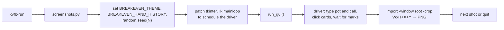

# Generate the README screenshots in CI

Status: proposed
Issue: #21

## Problem

The seven images in `docs/images/` were captured once, by hand, for #18. The
next change to the window will make them wrong, and nothing will tell us. The
driver that made them was a scratch script that never reached the repo.

## What gets built

1. **`scripts/screenshots.py`**: drives the real app under a virtual display
   and writes every image in `docs/images/`.
2. **`scripts/sample-hands/`**: a small synthetic PokerStars hand history the
   review screenshots read. Made-up players and hands, fixed in the repo.
3. **A `screenshots` job** in `.github/workflows/build.yml` that regenerates
   the images and acts on any difference (Decision 1 below).
4. **A README line** saying how to regenerate them.

No change to `breakeven.py`. Nothing the user downloads changes.

## How the driver works

This is the approach that produced the current images, rebuilt as a script.



- **Run under Xvfb.** `xvfb-run -s "-screen 0 2400x2000x24"`, so there is a
  display with no monitor. Ubuntu needs `python3-tk`, `xvfb` and
  `imagemagick` (`apt-get install`).
- **One process per image pair, per theme.** The script runs itself as a
  child process for each theme with `BREAKEVEN_THEME=light` or `dark` (the
  app already reads it), so each window is built in the right colours from
  the start.
- **Fixed randomness.** `random.seed(SEED)` before `run_gui()`, so the
  equity, the outs and the danger cards come out the same in light and dark.
  Once #23 lands, the app seeds each spot itself and the global seed no
  longer matters for the numbers; it stays as a belt-and-braces measure.
- **Hook in after startup.** Patch `tkinter.Tk.mainloop` so that, before
  calling the real one, it schedules the driver with `root.after(...)`. The
  app starts normally and the driver runs inside its event loop, with no
  change to `breakeven.py`.
- **Find widgets by walking the tree.** The driver walks
  `root.winfo_children()` to find the pot and call `Entry` widgets, the deck
  `Canvas` and the "Review session" label. It doesn't reach into
  `run_gui()`'s locals.
- **Enter the spot.** Set the pot and call entries with `delete` + `insert`;
  the app recalculates from a trace on their variables, so nothing else is
  needed. Pick cards with
  `event_generate("<Button-1>", x=…, y=…)` on the deck canvas, which is a
  grid of 13 columns (A, K, … 2) by 4 rows (♠ ♥ ♦ ♣). The click point is the
  centre of a cell, computed from the canvas's current width and height, so
  it holds at any window size.
- **Wait for the answer, not for a timer.** The next-card marks are worked out
  on a thread. The driver polls (every 100 ms, up to 30 s) until the deck
  header shows its counts, then waits one more idle cycle so the canvas has
  redrawn. A timeout fails the script loudly instead of saving a half-drawn
  image.
- **Review.** `BREAKEVEN_HAND_HISTORY` points at `scripts/sample-hands/`. The
  driver fires `<ButtonRelease-1>` on the "Review session" label (it is a
  label styled as a button, bound to release), then selects the "Your spots"
  and "Players" tabs in turn and grabs the review window.
- **Grab.** `root.update()`, then `winfo_rootx/rooty/width/height` give the
  window's rectangle, and ImageMagick's
  `import -window root -crop WxH+X+Y +repage -strip out.png` grabs it.
  `-strip` drops the timestamps ImageMagick writes into a PNG, so the same
  pixels give the same bytes.
- **2× without a HiDPI display.** The app draws everything at a base size
  times a scale that follows the window size, so the driver sets the window
  to twice its natural size with `geometry()` and lets it settle. The output
  is a true 2× image: the calculator comes out 1456×1670 and the review
  1800 wide, the sizes the README already uses at `width="560"` and `760`.
- **Fonts.** The app asks for Geist and IBM Plex Mono and falls back to
  DejaVu. The job installs both, pinned: IBM Plex Mono from Ubuntu's
  `fonts-ibm-plex`, and Geist from a pinned release of `vercel/geist-font`
  checked against a SHA-256 in the script. That makes the CI images match
  what a Mac with the fonts installed shows, and stops a fallback font
  sneaking in unnoticed. The script refuses to run if either font is
  missing (`tkinter.font.families()`), rather than produce off-brand images.

## The images it writes

The existing names in `docs/images/`, so the README doesn't change:

| File | What it shows | Size |
|---|---|---|
| `calculator-light.png`, `calculator-dark.png` | The calculator on the hero spot (Decision 2) | 1456×1670 |
| `review-spots-light.png`, `review-spots-dark.png` | The "Your spots" tab on the sample hands | 1800×1000 |
| `review-players-light.png`, `review-players-dark.png` | The "Players" tab on the sample hands | 1800×560 |
| `social-preview.png` | The repo's link preview: the dark calculator, framed on a 1280×640 canvas with the app name and tagline | 1280×640 |

`social-preview.png` is composed with ImageMagick from the dark calculator
grab, so it can't drift from it. GitHub doesn't read it from the repo: after it
changes, someone uploads it in Settings → Social preview. The job prints a
reminder when it changes.

The sample hands are about 20 synthetic 6-max cash hands at $0.01/$0.02 with
five invented players, written so the tables show every grade ("call paid",
"good fold", "called short") and at least three player styles. The README
already says the images are "real captures of the app on sample hands"; that
stays true.

## Which spot to show

The hero image should show what makes Breakeven different: the verdict *and*
the deck marked with outs, helpers and danger cards. I checked candidate spots
with #23's settings (1,500 next-card hands, three different seeds):

| Spot | Outs / helps / danger |
|---|---|
| A♥K♥ on Q♥7♥2♣, one opponent, 20 into 60 (today's image) | 15 / 0–2 / **0** |
| K♠K♦ on T♥9♥4♣, two opponents, 30 into 60 | 1 / 9–17 / 5–7 |
| 8♠8♦ on 8♥7♥6♣, one opponent, 30 into 60 | 0 / 7 / 10–12 |

Today's spot never shows a danger card. K♠K♦ on a wet board shows all three
marks. The counts still move between seeds, which is #23's point: once #23 seeds
each spot itself, whichever spot we pick shows the same marks every run, in CI
and on a user's machine. So this should build after #23, and Decision 2 picks
the spot.

## The workflow change (protected area)

A new job in `.github/workflows/build.yml`, alongside `test`. Sketch:

```yaml
  screenshots:
    runs-on: ubuntu-24.04        # pinned image: font rendering moves with it
    steps:
      - uses: actions/checkout@v7
      - run: sudo apt-get update && sudo apt-get install -y xvfb imagemagick python3-tk fonts-ibm-plex
      - run: python3 scripts/screenshots.py --install-fonts --out docs/images
      - run: python3 scripts/screenshots.py --compare docs/images   # see Decision 1
      - uses: actions/upload-artifact@v7
        if: always()
        with: { name: screenshots, path: docs/images }
```

- It runs on pull requests and on pushes to `main`, and only when something
  that can change a picture changed: `breakeven.py`, `assets/**`,
  `scripts/screenshots.py`, `scripts/sample-hands/**` or the workflow.
- It does not gate the Windows and Mac builds or the release job.
- It adds about 1–2 minutes of Linux runner time when it runs (apt install,
  seven captures with a few seconds of simulation each). Free on a public
  repo.
- **Comparing images.** A byte-for-byte check would fail whenever the runner's
  FreeType or Tk changes how a glyph is anti-aliased. So `--compare` measures
  the share of pixels that differ by more than a small fuzz
  (ImageMagick `compare -metric AE -fuzz 5%`) and counts an image as changed
  only above a threshold (start at 0.5% of pixels). A changed number, a moved
  card or a new colour moves far more than that; a re-hinted glyph edge
  doesn't. The threshold lives in the script, so tuning it is a one-line PR.
- What the job does with a real difference is Decision 1. The permissions it
  needs depend on that choice; the existing `contents: write` at the top of
  the workflow stays as it is.

Because this changes CI, the build PR needs your merge, not the builder's.

## Options I rejected

- **Pixel-exact comparison.** Flaky on every runner image update for no gain.
- **Playwright or a browser.** The app is Tk, not a web page.
- **Screenshots on macOS runners.** Closer to what most users see, but screen
  capture there needs a privacy permission a hosted runner can't grant
  without workarounds, and the images would still change with each macOS
  image.
- **Changing the app to add a screenshot mode.** The issue rules out app
  changes, and the `mainloop` patch doesn't need one.
- **An animated GIF.** Out of scope for #21; a possible follow-up.

## Cost

- **Build:** size M. One script (about 250 lines), a sample hand file, a
  workflow job and a README line.
- **Running cost:** about 1–2 Linux runner minutes on PRs that touch the app.
  Nothing hosted.
- **Maintenance:** the driver finds widgets by type and text, so a layout
  change that renames "Review session" or replaces the deck canvas breaks it
  loudly in CI, which is the point. Runner image updates may move a few
  pixels; the fuzz threshold absorbs that, and a real font change shows up as
  a refresh (Decision 1).

## Decisions for Anthony

### 1. What CI does when the images change

- **A. Auto-commit to the PR branch.** The job pushes regenerated images onto
  the PR as a bot commit. Nobody has to do anything, and the reviewer sees the
  new images in the diff. But a commit pushed with the workflow's own token
  doesn't trigger CI, so the PR's head has no checks on it until someone
  pushes again; PRs from forks can't be pushed to at all; and every builder
  has to pull before pushing again.
- **B. Fail on drift, upload the new images.** The job fails with "screenshots
  are out of date" and attaches the regenerated images as a run artifact. The
  builder downloads them, commits them, and pushes. Simple and visible, no
  bot commits, but it turns a red check into a manual chore on every UI PR,
  and a runner font change could fail an unrelated PR.
- **C. Refresh PR after merge (recommended).** PRs only get a non-blocking
  job summary ("these images will change"). After a merge to `main`, if the
  images changed, the job opens (or updates) a single PR, "Refresh README
  screenshots", with the new images, using
  `peter-evans/create-pull-request`. You merge it when you like. No red checks
  from fonts, no bot commits on anyone's branch, nothing pushed to `main`, and
  you see the pictures before they go live. Costs: one extra PR to merge after
  a UI change; it needs "Allow GitHub Actions to create pull requests" turned
  on in Settings → Actions, and `pull-requests: write` on that job. The same
  token rule as A applies: CI doesn't run on that PR, which is fine because
  it only changes PNGs.

### 2. Which spot the calculator image shows

- **A. K♠K♦ on T♥9♥4♣, two opponents, 30 into 60 (recommended).** Shows the
  verdict with all three marks: an out, helpers and danger cards.
- **B. Keep A♥K♥ on Q♥7♥2♣, 20 into 60.** Matches the issue and today's image
  with its 15 green outs, but no danger cards.
- **C. 8♠8♦ on 8♥7♥6♣, 30 into 60.** The most red on the deck, but no outs.

Either way the build waits for #23 so the marks are stable.

## Proposed issues

Once accepted, #21 is the build issue (with its Decisions updated from this
proposal), blocked by #23. No other issues.
